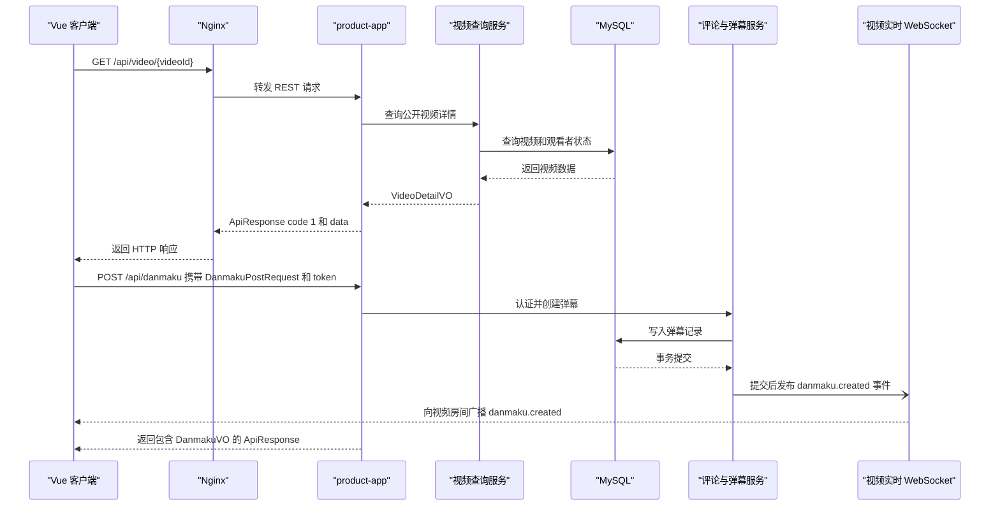

# API 接口与服务通信说明

本文供前端开发、联调和维护使用，涵盖当前后端 REST 接口、WebSocket 通道及主要请求约定。REST 接口超过 100 个，按业务分组列出；字段详情以 DTO/VO 类型为准。

> **快速上手**
> - **API 基础路径：** `/api`。表格中的 REST 路径均不含此前缀，例如 `POST /auth/login` 的完整路径为 `POST /api/auth/login`。
> - **认证：** 登录后将 token 放入 `token` 请求头；是否需要登录以各接口的业务权限为准。
> - **响应：** 业务成功时通常返回 `{code: 1, data: ...}`；表格中的响应类型指 `data`。
> - **实时通信：** 私信、视频实时状态和一起看使用 WebSocket，认证方式各不相同，详见下文。

## 目录

- [服务与部署入口](#服务与部署入口)
- [REST 接口](#rest-接口)
- [WebSocket 实时接口](#websocket-接口)
- [管理与监控](#管理与可观测性接口)
- [数据契约](#dto-与数据契约)
- [通信、认证与兼容性](#通信模式)
- [服务能力概览](#服务技术能力矩阵)
- [请求时序示例](#服务通信时序)

## 服务与部署入口

| 名称 | 端口 | 类型 | 用途 |
|---|---|---|---|
| `product-app` | 8081 | 后端应用 | 提供 REST API、管理接口及 WebSocket 实时通道 |
| `product-domain` | — | Maven 模块 | 领域模型与持久化映射，不单独部署 |
| `product-common` | — | Maven 模块 | 统一响应、异常与通用组件，不单独部署 |
| Web 客户端 / Nginx | 80/443 | 前端与反向代理 | 提供静态页面；将 `/api/` 转发至 `product-app:8081`，并支持 WebSocket Upgrade |

项目是 Maven 多模块单体应用：只有 `product-app` 独立运行；`product-domain` 和 `product-common` 是共享代码模块。未发现其他自建微服务、消息代理或独立 API 网关。

## REST 接口

下表接口均由 `product-app` 提供。请求列说明请求体或主要参数；未特别标注时，请求体为 JSON，路径参数和查询参数按路径定义传入。响应为“无”表示接口不返回业务数据。统一响应还可能包含 `msg`、`traceId` 和 `timestamp`；业务错误信息见 `msg`。HTTP 状态码由 Spring 和统一异常处理逻辑决定。

### 认证与账号 `AuthController`

| 方法 | 路径 | 请求 / 参数 | 响应（`data`） |
|---|---|---|---|
| POST | `/auth/register` | JSON `RegisterRequest` | `Map<String,Object>`（含 token） |
| POST | `/auth/login` | JSON `LoginRequest` | `Map<String,Object>`（含 token） |
| POST | `/auth/logout` | `token` 请求头 | 无 |
| GET | `/auth/me` | `token` 请求头 | `UserProfileVO` |
| GET | `/auth/user/{userId}` | 路径参数 `userId` | `UserProfileVO` |
| PUT | `/auth/profile` | JSON `ProfileUpdateRequest` | 无 |
| PUT | `/auth/account` | JSON `AccountUpdateRequest` | 无 |
| PUT | `/auth/privacy` | JSON `PrivacyUpdateRequest` | 无 |
| GET | `/auth/ping` | 可选 `token` 请求头 | 当前用户 ID 或 `anonymous` |

### 视频浏览、互动与弹幕 `VideoController`、`InteractionController`、`CommentDanmakuController`

| 方法 | 路径 | 请求 / 参数 | 响应（`data`） |
|---|---|---|---|
| GET | `/video/categories` | 无 | `List<CategoryVO>` |
| GET | `/video/list` | 查询参数 `VideoListQuery` | `PageResult<VideoListItemVO>` |
| GET | `/video/{videoId}` | 路径参数 `videoId` | `VideoDetailVO` |
| POST | `/video/{videoId}/play` | 路径参数 `videoId` | 无 |
| GET | `/video/{videoId}/folders` | 路径参数 `videoId` | `List<Map<String,Object>>` |
| GET | `/video/getVideoTitle/{videoId}` | 路径参数 `videoId` | `String` |
| POST | `/video/{videoId}/like` | 路径参数 `videoId` | 互动状态 `Map<String,Object>` |
| POST | `/video/{videoId}/favorite` | 路径参数 `videoId`；可选查询参数 `folderId` | 互动状态 `Map<String,Object>` |
| POST | `/video/{videoId}/watch-later` | 路径参数 `videoId` | 互动状态 `Map<String,Object>` |
| POST | `/video/{videoId}/watch` | 路径参数 `videoId`；查询参数 `progressSeconds`（默认 0） | 观看状态 `Map<String,Object>` |
| GET | `/video/{videoId}/state` | 路径参数 `videoId`；支持匿名查询 | 互动状态 `Map<String,Object>` |
| GET | `/comment/list` | 查询参数 `videoId`/`postId`/`cursorId`/`sort`/`size` | 评论分页 `Map<String,Object>` |
| POST | `/comment` | JSON `CommentPostRequest` | `{commentId: ...}` |
| GET | `/comment/{commentId}` | 路径参数 `commentId` | `CommentVO` |
| POST | `/comment/{commentId}/pin` | 路径参数 `commentId` | `{pinned: boolean}` |
| POST | `/comment/{commentId}/like` | 路径参数 `commentId`；可选查询参数 `dislike` | 赞/踩状态 `Map<String,Object>` |
| DELETE | `/comment/{commentId}` | 路径参数 `commentId` | 无 |
| GET | `/danmaku/list` | 查询参数 `videoId`；可选 `limit`（默认 2000） | `List<DanmakuVO>` |
| POST | `/danmaku` | JSON `DanmakuPostRequest` | `DanmakuVO` |
| GET | `/danmaku/snapshot` | 查询参数 `videoId`；可选 `limit`（默认 2000） | 快照 `Map<String,Object>` |
| DELETE | `/danmaku/{danmakuId}` | 路径参数 `danmakuId` | `{count: ...}` |

### 首页、用户空间与关系 `HomeController`、`SocialController`

| 方法 | 路径 | 请求 / 参数 | 响应（`data`） |
|---|---|---|---|
| GET | `/home/featured` | 查询参数 `HomeQueryRequest` | `PageResult<VideoListItemVO>` |
| PUT | `/home/featured` | JSON `List<Long>` 视频 ID | `null` |
| GET | `/home/contribute` | 查询参数 `HomeQueryRequest` | `PageResult<VideoListItemVO>` |
| GET | `/home/love` | 查询参数 `HomeQueryRequest` | `List<VideoListItemVO>` |
| GET | `/home/collectsClassify` | 查询参数 `HomeQueryRequest` | `List<FolderVO>` |
| GET | `/home/collectByName` | 查询参数 `HomeQueryRequest` | `PageResult<VideoListItemVO>` |
| GET | `/home/dynamic` | 查询参数 `HomeQueryRequest` | `PageResult<PostVO>` |
| GET | `/home/dynamicImg` | 查询参数 `HomeQueryRequest` | `PageResult<HomeImageItemVO>` |
| GET | `/home/relations` | 查询参数 `homeUserId`、`type`；可选 `pageNum`、`keyWord` | `PageResult<UserBriefVO>` |
| POST | `/user/{userId}/follow` | 路径参数 `userId` | 关注状态 `Map<String,Object>` |
| PUT | `/user/{userId}/follow` | 路径参数 `userId` | `null` |
| DELETE | `/user/{userId}/follow` | 路径参数 `userId` | `null` |
| GET | `/post/list` | 查询参数 `targetUserId`、`cursorId`、`size`、`followingOnly` | 动态分页 `Map<String,Object>` |
| POST | `/post/{postId}/pin` | 路径参数 `postId` | `Boolean` |
| GET | `/user/mentions` | 可选查询参数 `cursorId` | 提及用户分页 `Map<String,Object>` |
| GET | `/post/authors` | 可选查询参数 `cursorId` | 作者分页 `Map<String,Object>` |
| POST | `/post/read` | 可选查询参数 `targetUserId` | `null` |
| GET | `/post/{postId}` | 路径参数 `postId` | `PostVO` |
| POST | `/post/{postId}/like` | 路径参数 `postId` | 点赞状态/动态 `Map<String,Object>` |
| POST | `/post/{postId}/share` | 路径参数 `postId`；JSON 收件人 ID 和内容 | 分享结果 `Map<String,Object>` |
| POST | `/post` | JSON `PostRequest` | `{postId:number}` |
| DELETE | `/post/{postId}` | 路径参数 `postId` | `null` |
| GET | `/relation/list` | 查询参数 `type`、`size`；可选 `userId`、`cursorId` | 关系分页 `Map<String,Object>` |
| GET | `/privateMessage/selectNotReadNumber` | 查询参数 `userId` | 未读数量 `Integer` |
| GET | `/user/{userId}/videos` | 路径参数 `userId`；可选查询参数 `cursorId`、`size` | 用户视频分页 `Map<String,Object>` |

### 收藏夹、稍后看与历史（`UserContentController`, `HomeLibraryController`）

| 方法 | 路径 | 请求 / 参数 | 响应（`data`） |
|---|---|---|---|
| GET | `/folder/list` | `token` 请求头 | `List<FolderVO>` |
| GET | `/folder/videos` | 查询参数 `folderId`、`pageNum`、`pageSize` | `PageResult<VideoListItemVO>` |
| POST | `/folder` | JSON `FolderRequest` | `FolderVO` |
| PUT | `/folder/{folderId}` | 路径参数 `folderId`；JSON `FolderRequest` | `null` |
| DELETE | `/folder/{folderId}` | 路径参数 `folderId` | `null` |
| DELETE | `/folder/{folderId}/video/{videoId}` | 路径参数 `folderId`、`videoId` | `null` |
| POST | `/home/folders/{folderId}/batch` | 路径参数 `folderId`；JSON `HomeLibraryRequest` | 影响条数 `Integer` |
| DELETE | `/home/folders/{folderId}/invalid` | 路径参数 `folderId` | 删除条数 `Integer` |
| GET | `/watch-later/list` | 查询参数 `UserLibraryQuery` | 游标分页 `Map<String,Object>` |
| DELETE | `/watch-later/batch` | JSON `UserLibraryBatchRequest` | `null` |
| DELETE | `/watch-later/{videoId}` | 路径参数 `videoId` | `null` |
| DELETE | `/watch-later` | `token` 请求头 | `null` |
| GET | `/history/list` | 查询参数 `UserLibraryQuery` | 游标分页 `Map<String,Object>` |
| DELETE | `/history/batch` | JSON `UserLibraryBatchRequest` | `null` |
| DELETE | `/history/{videoId}` | 路径参数 `videoId` | `null` |
| DELETE | `/history` | `token` 请求头 | `null` |

### 搜索与视频投稿（`SearchController`、`PublishingController`）

| 方法 | 路径 | 请求 / 参数 | 响应（`data`） |
|---|---|---|---|
| GET | `/search/video` | 查询参数 `SearchQuery` | `PageResult<VideoListItemVO>` |
| GET | `/search/user` | 查询参数 `UserSearchQuery` | `PageResult<UserSearchItemVO>` |
| GET | `/search/post` | 查询参数 `SearchQuery` | `PageResult<PostVO>` |
| GET | `/search/hot` | 可选查询参数 `limit`（默认 10） | `List<KeywordVO>` |
| POST | `/upload/uploadVideoChunk` | multipart 文件 `file`；查询参数 `uploadId`、`chunkIndex`、`totalChunks` | 已接收分片序号 `Integer` |
| POST | `/upload/mergeVideoChunks` | 查询参数 `uploadId`、`totalChunks` | 合并后的视频标识 `String` |
| DELETE | `/upload/cleanVideoUpload` | 可选查询参数 `uploadId`、`videoName` | `null` |
| POST | `/upload/uploadVideo` | multipart 表单/模型 `PublishingRequest`；可选文件/名称及可重复的 `tag[]` | 操作消息 `String` |
| PUT | `/upload/updateVideo` | multipart 表单/模型 `PublishingRequest`；可选文件/名称及可重复的 `tag[]` | 操作消息 `String` |
| GET | `/video/getVideoInfo` | 查询参数 `videoId` | `Map<String,Object>` |
| GET | `/video/userUploadVideo` | 查询参数 `videoTitle`、`subZoneKey`、`sortWay`、`videoStatus`、`pageNum` | `Map<String,Object>` |
| DELETE | `/video/deleteVideo` | 查询参数 `videoId` | 操作消息 `String` |
| POST | `/video/selectVideoData` | `token` 请求头 | 统计数据 `Map<String,Object>` |

### 私信与通知（`PrivateMessageController`、`NotificationCenterController`、`MentionNotificationController`）

| 方法 | 路径 | 请求 / 参数 | 响应（`data`） |
|---|---|---|---|
| GET | `/privateMessage/selectDialogue` | 查询参数 `pageNum`；可选 `dialogueId` | 会话列表 |
| POST | `/privateMessage/addDialogue` | JSON `DialogueRequest` | 会话 ID `Long` |
| GET | `/privateMessage/selectMessage` | 查询参数 `dialogueId`、`pageNum` | 消息分页 `Map<String,Object>` |
| POST | `/privateMessage/sendMessage` | JSON `SendRequest` | 消息 `Map<String,Object>` |
| PUT | `/privateMessage/putMessageStatus` | 查询参数 `dialogueId` | `null` |
| PUT | `/privateMessage/putUpStatus` | 查询参数 `id` | `null` |
| PUT | `/privateMessage/putDndStatus` | 查询参数 `id` | `null` |
| DELETE | `/privateMessage/deleteDialogue` | 查询参数 `id` | `null` |
| DELETE | `/privateMessage/revocationMessage` | 查询参数 `id` | `null` |
| DELETE | `/privateMessage/deleteMessage` | 查询参数 `id` | `null` |
| PUT | `/user/putMessageSettings` | JSON 设置记录 | `null` |
| GET | `/comment/selectReplayComment` | 查询参数 `pageNum` | 通知列表 |
| GET | `/comment/selectAt` | 查询参数 `pageNum` | 通知列表 |
| GET | `/comment/selectLike` | 查询参数 `pageNum` | 通知列表 |
| GET | `/comment/selectLikeUser` | 查询参数 `id`、`type`、`pageNum` | 用户列表 |
| PUT | `/privateMessage/putMessageNumber` | 查询参数 `messageMenu` | `null` |
| DELETE | `/comment/deleteCommentNotification` | 查询参数 `commentId`、`messageMenu`；可选 `type` | `null` |
| PUT | `/comment/dndLikeNotification` | 查询参数 `id`、`type` | `{muted:boolean}` |
| GET | `/notification/mentions` | 可选查询参数 `cursorId`、`size` | 提及通知分页 `Map<String,Object>` |
| GET | `/notification/unread` | `token` 请求头 | 未读数量 `Map<String,Object>` |
| POST | `/notification/mentions/read` | JSON `List<Long>` ID 列表 | `null` |
| DELETE | `/notification/mentions/{id}` | 路径参数 `id` | `null` |
| GET | `/share/recipients` | 可选查询参数 `cursorId` | 收件人分页 `Map<String,Object>` |
| POST | `/video/{videoId}/share` | 路径参数 `videoId`；JSON 收件人 ID 和内容 | 分享结果 `Map<String,Object>` |

### 媒体、管理与横幅（`MediaController`、`AdminController`、`BannerController`）

| 方法 | 路径 | 请求 / 参数 | 响应（`data`） |
|---|---|---|---|
| POST | `/media/{category}` | multipart 文件 `file`；路径参数 `category` | `{url:string}` |
| GET | `/system/overview/getOverview` | 已登录管理员 | 概览对象 |
| POST | `/system/user/searchUsers` | JSON `AdminQuery` | 搜索结果 |
| GET | `/system/user/searchBanList` | 查询参数 `AdminQuery` | 搜索结果 |
| POST | `/system/content/searchComments` | JSON `AdminQuery` | 搜索结果 |
| POST | `/system/content/searchDynamics` | JSON `AdminQuery` | 搜索结果 |
| POST | `/system/content/searchMessages` | JSON `AdminQuery` | 搜索结果 |
| POST | `/system/keyWord/searchKeyWords` | JSON `AdminQuery` | 搜索结果 |
| POST | `/system/log/searchLogs` | JSON `AdminQuery` | 搜索结果 |
| POST | `/system/video/searchVideos` | JSON `AdminQuery` | 搜索结果 |
| GET | `/system/video/getSubZoneKeys` | 已登录管理员 | 分区列表 |
| PUT | `/system/user/putAdmin` | 查询参数 `targetId`；JSON `AdminCommand` | 操作结果 |
| POST | `/system/user/banUser` | 查询参数 `targetId`；JSON `AdminCommand` | 操作结果 |
| POST | `/system/user/unbanUser` | 查询参数 `targetId`；JSON `AdminCommand` | 操作结果 |
| POST | `/system/content/deleteComment` | JSON `AdminCommand` | 操作结果 |
| POST | `/system/content/deleteDynamic` | JSON `AdminCommand` | 操作结果 |
| POST | `/system/content/deleteMessage` | JSON `AdminCommand` | 操作结果 |
| POST | `/system/content/sendPrivateMessage` | JSON `AdminCommand` | 操作结果 |
| POST | `/system/content/switchCommentOffShelf` | 查询参数 `offShelf`；JSON `AdminCommand` | 操作结果 |
| POST | `/system/content/switchDynamicOffShelf` | 查询参数 `offShelf`；JSON `AdminCommand` | 操作结果 |
| POST | `/system/keyWord/addKeyWord` | 查询参数 `word`；JSON `AdminCommand` | 操作结果 |
| PUT | `/system/keyWord/putKeyWord` | 查询参数 `keyWordId`、`word`；JSON `AdminCommand` | 操作结果 |
| PUT | `/system/keyWord/putKeyWordCount` | 查询参数 `keyWordId`、`count`；JSON `AdminCommand` | 操作结果 |
| POST | `/system/keyWord/deleteKeyWord` | JSON `AdminCommand` | 操作结果 |
| POST | `/system/video/deleteVideo` | JSON `AdminCommand` | 操作结果 |
| POST | `/system/video/examineVideo` | 查询参数 `videoId`；JSON `AdminCommand` | 操作结果 |
| POST | `/system/video/rejectVideo` | 查询参数 `videoId`；JSON `AdminCommand` | 操作结果 |
| POST | `/system/video/takeDownVideo` | 查询参数 `videoId`；JSON `AdminCommand` | 操作结果 |
| PUT | `/system/video/restoreVideo` | 查询参数 `videoId`；JSON `AdminCommand` | 操作结果 |
| GET | `/banner` | 无 | `List<Banner>` |
| GET | `/system/banner` | 查询参数 `pageNum`、`keyword` | `PageResult<Banner>` |
| POST | `/system/banner` | JSON `BannerRequest` | `Banner` |
| PUT | `/system/banner/{id}` | 路径参数 `id`；JSON `BannerRequest` | `Banner` |
| DELETE | `/system/banner/{id}` | 路径参数 `id` | `null` |
| POST | `/system/banner/image` | multipart 文件 `file` | `{url:string}` |

### 实时协作（`WatchTogetherController`）

| 方法 | 路径 | 请求 / 参数 | 响应（`data`） |
|---|---|---|---|
| POST | `/watch-together/rooms` | JSON `CreateWatchRoomRequest`；可选 `Authorization` 请求头 | `WatchRoomVO` |
| GET | `/watch-together/history` | 可选 `Authorization` 请求头 | `List<WatchRoomVO>` |

### WebSocket 接口

| 路径 | 认证方式 / 客户端消息 | 服务端消息 |
|---|---|---|
| `/api/chat` | WebSocket；查询参数 `token`；客户端发送 `{"type":"ping"}` | `ready`、`messages.changed`（变更类型及会话/消息信息） |
| `/api/video/live?videoId={id}` | WebSocket；查询参数为已发布视频 ID；客户端发送固定 ping JSON | `pong`、在线状态更新、`danmaku.created`、`danmaku.deleted` |
| `/api/watch-together/socket` | WebSocket；查询参数 `Authorization` 携带 token；客户端发送 JSON `WatchMessage` | 房间状态、播放同步、参与者信息和操作错误；操作类型包括 `join`、`leave`、`sync`、`play`、`pause`、`seek`、`rate`、成员管理及 `ping` |

未发现 REST API 版本方案：路径中没有 `/v1`，也未发现版本请求头。

> **认证提示：** REST 写操作通常需要登录；开放读取接口可匿名访问。管理操作还需要管理员权限。具体认证行为以服务端实际权限校验为准。

## 管理与可观测性接口

| 项目能力 | 发现情况 |
|---|---|
| `/api/auth/ping` | 仅检查应用登录上下文，不是健康检查或就绪探针 |
| Actuator / health / metrics | 未发现 Actuator 依赖、管理接口配置或自定义指标 |
| Knife4j / OpenAPI | Maven 父 POM 中存在 Knife4j 依赖；未发现已提交的 OpenAPI 规范文件或明确的 API 文档配置 |

应用源码未定义独立的运行状态健康检查 URL。如需使用 Knife4j，请在部署环境确认实际生效的文档 UI 路径。

## DTO 与数据契约

- 统一响应信封为 `ApiResponse<T>`，包含 `code`、`msg`、`data`、可选的 `traceId` 和 `timestamp`；`code == 1` 表示成功。Jackson 会排除空值，并按应用配置序列化日期。
- 请求 DTO 包括：`RegisterRequest`、`LoginRequest`、`AccountUpdateRequest`、`ProfileUpdateRequest`、`PrivacyUpdateRequest`、`VideoListQuery`、`SearchQuery`、`UserSearchQuery`、`HomeQueryRequest`、`CommentPostRequest`、`DanmakuPostRequest`、`PostRequest`、`FolderRequest`、`HomeLibraryRequest`、`UserLibraryQuery`、`UserLibraryBatchRequest`、`PublishingRequest`、`AdminQuery`、`AdminCommand`、`BannerRequest` 和 `CreateWatchRoomRequest`。
- 接口签名还使用了 `DialogueRequest`、`SendRequest`、一起看房间消息 `WatchMessage` 和通知设置等请求类型。通知设置类型以内嵌形式定义在所属接口中，未列为主要 DTO。
- 响应/视图类型包括：`UserProfileVO`、`VideoDetailVO`、`VideoListItemVO`、`VideoPageVO`、`CategoryVO`、`CommentVO`、`DanmakuVO`、`PostVO`、`FolderVO`、`HomeImageItemVO`、`KeywordVO`、`UserBriefVO`、`UserReactionVO`、`UserSearchItemVO`、`UserLibraryVideoVO`、`WatchRoomVO` 和 `WatchParticipantVO`。部分接口也直接返回 Map 或 List。
- 项目没有单独的 API 网关 DTO 层；上述类型是应用级请求/响应契约。Java record（如有）不可变；普通 DTO/VO 类不默认视为不可变。
- 未发现 protobuf 或 GraphQL schema，也未发现已提交的 OpenAPI/Swagger 规范文件。

实体字段和持久化归属请参见数据架构文档，此处不重复列举数据结构。

## 通信模式

- 浏览器通过 Nginx 以同步 HTTP/JSON 方式访问 REST 接口。Nginx 将 `/api/` 转发到端口 8081 上的 `product-app`，并转发 WebSocket Upgrade 请求头。前端 API 基础路径默认为 `/api`；Axios 超时时间为 30 秒。
- `product-app` 直接调用进程内业务服务，并使用 MyBatis/MyBatis-Plus 进行持久化。MySQL 和 Redis 配置为基础设施依赖；未发现独立服务发现、客户端负载均衡、外部 REST 客户端、Kafka/RabbitMQ/Azure Service Bus，或熔断器类库/配置。
- 私信和视频实时更新使用 WebSocket。私信与弹幕变更在数据库事务提交后通过进程内事件发布，再由 WebSocket 处理器推送给已连接会话。一起看消息由同一个应用直接处理。
- 前端 WebSocket 重连采用指数退避，最长间隔为 30 秒。私信心跳间隔为 20 秒，视频实时通道心跳间隔为 25 秒；客户端分别在 60 秒和 75 秒未收到有效消息后关闭过期连接。这些是客户端重连/心跳策略，不是 HTTP 重试策略。未发现 REST 重试或熔断策略。
- REST 认证使用 Sa-Token，token 名称为 `token`；前端将其放入 `token` 请求头。受保护操作通过 Sa-Token 拦截器和 `AuthContext` 执行登录校验；部分读取接口允许匿名访问。WebSocket 认证因接口而异：`chat` 使用查询参数 `token`；一起看创建/历史和 Socket 使用 `Authorization`；视频实时通道不要求用户 token，而是校验视频 ID。
- 管理操作会将当前认证用户上下文传入管理服务，并在服务层执行授权校验。并非所有接口都要求登录：公开视频、搜索、横幅读取接口以及 `/auth/ping` 允许匿名访问。
- Nginx 配置在生产域名上通过 HTTPS 终止 TLS，并将 HTTP 重定向至 HTTPS。Spring Boot 应用本身在端口 8081 上使用 HTTP；TLS 在代理层处理。
- 前端仍保留与当前 Controller 路由不匹配的旧 API 封装，例如 `/dynamic/*`、`/collect/*`、`/video/selectVideo`。这些路径没有对应的后端 Controller 映射；请使用本清单列出的 `/post/*`、`/folder/*` 等当前接口。`/auth/account` 和 `/user/putMessageSettings` 则是后端实际存在的接口，不属于上述路由差异。

## 服务技术能力矩阵

| 服务 | Web 框架 | 数据访问 | 服务发现 | 网关 | Actuator | 缓存 | 指标 |
|---|---|---|---|---|---|---|---|
| product-app | Spring MVC / 内嵌 Servlet；WebSocket | MyBatis-Plus / MyBatis；MySQL；Redis 客户端 | 未发现 | 提供自身 API；无独立网关 | 未发现 Actuator | 存在 Spring 缓存注解；实现/配置详情不属于本文范围 | 未发现指标导出器或自定义指标 |
| product-domain | 类库模块，无 Web 监听器 | 领域模型/持久化模型类库 | 不适用 | 不适用 | 不适用 | 不适用 | 不适用 |
| product-common | 共享类库，无 Web 监听器 | 不适用 | 不适用 | 不适用 | 不适用 | 不适用 | 不适用 |
| Web 客户端 / Nginx | Vue 单页应用 / Nginx 反向代理 | 不适用 | 不适用 | `/api/` 反向代理 | 不适用 | Nginx 配置了静态资源/媒体缓存响应头 | 不适用 |

## 服务通信时序

<!-- mermaid-checked: every participant uses `participant Id as "Label"`, no \n in aliases/messages/notes, every alt/opt/loop closed by end, no `:` inside any alias -->
