# 业务流程与功能导航

青芒视频围绕视频内容构建用户社区：用户可以观看、投稿、互动、社交和一起看，管理员负责内容审核与平台运营。本指南按用户与管理员的实际操作组织流程；流程图突出关键决策和结果，不替代页面说明或接口字段文档。

## 阅读指南

- **普通用户流程：** 注册登录、观看互动、投稿审核、社交、个人内容库。
- **其他功能流程：** 首页搜索、私信通知、一起看、管理后台、账号设置和横幅展示。
- **图例：** 圆角框表示操作或结果，菱形表示需要判断的分支；接口地址以当前后端路由为准。
- **相关文档：** [API 接口与服务通信说明](./API接口与服务通信说明.md)列出请求参数、响应类型和实时通道。

## 目录

- [领域实体](#领域实体)
- [服务与业务域映射](#服务与业务域映射)
- [主要业务流程](#主要业务流程)
- [其他功能流程图](#其他功能流程图)
- [跨业务数据流](#跨业务数据流)
- [业务流程时序图](#业务流程时序图)
- [业务规则与决策逻辑](#业务规则与决策逻辑)

## 领域实体

| 实体 | 所属业务上下文 | 业务含义 | 主要关系 |
|---|---|---|---|
| `User`、`UserPrivacy`、`UserStats` | 用户与账号 | 平台账号、隐私偏好和用户统计信息 | 用户拥有空间、关注关系、互动记录和通知 |
| `Video`、`Category`、`VideoStats`、`VideoStatusLog` | 视频 | 视频内容、分区、统计和审核状态变化 | 视频由用户投稿，属于分区，关联弹幕、评论和用户互动 |
| `Danmaku`、`Comment`、`CommentLike`、`VideoReaction` | 视频互动 | 视频弹幕、评论及赞/踩互动 | 互动由用户发起并关联视频或评论 |
| `FavoriteFolder`、`FavoriteItem`、`WatchLater`、`WatchHistory` | 个人内容库 | 用户收藏夹、收藏条目、稍后看和观看历史 | 内容库条目归属于用户，并引用视频 |
| `UserPost`、`PostLike`、`UserFollow` | 动态与社交 | 用户动态、动态点赞和关注关系 | 动态归属作者；关注关系连接两个用户 |
| `Conversation`、`PrivateMessage`、`Notification` | 私信与通知 | 私信会话、消息和站内通知 | 消息属于会话并关联发送者/接收者；通知关联用户和业务事件 |
| `WatchRoom`、`WatchRoomMember` | 一起看 | 同步观看房间和成员 | 房间指定视频、房主及参与成员 |
| `Banner`、`SearchKeyword`、`OperationLog`、`UserBan` | 站点运营 | 横幅、搜索热词、操作审计和用户封禁 | 管理员操作会影响内容可见性、平台配置和账号状态 |

## 服务与业务域映射

| 服务/模块 | 业务上下文 | 负责实体 | 依赖与数据流 |
|---|---|---|---|
| `product-app` | API 接入与业务应用 | 编排用户、视频、互动、社交、私信、通知、运营和一起看业务 | 接收 Web/Nginx 请求，调用进程内应用服务并访问持久化层 |
| `product-domain` | 领域模型与持久化映射 | 用户、视频、互动、社交、个人内容库、一起看、运营实体 | 由 `product-app` 直接使用；不是独立运行的微服务 |
| `product-common` | 通用 API 与异常处理 | 统一响应、错误处理等通用契约 | 由应用模块共享；不是独立运行的微服务 |
| Web 客户端 / Nginx | 页面展示与 API 入口 | 页面状态和用户交互 | `/api/` 转发到 `product-app`；WebSocket 通道用于实时通知、在线状态和播放同步 |

项目采用同一应用中的模块内调用，没有跨微服务 REST 聚合或服务发现。私信与弹幕的事务提交后事件在应用内触发 WebSocket 推送。

## 主要业务流程

### 流程一：注册、登录与账号初始化

注册时创建用户，并在同一业务事务中初始化隐私设置、用户统计和默认收藏夹；成功后建立登录态并返回 token。登录时校验账号、密码和可用状态，通过后建立登录态并更新当日登录记录。

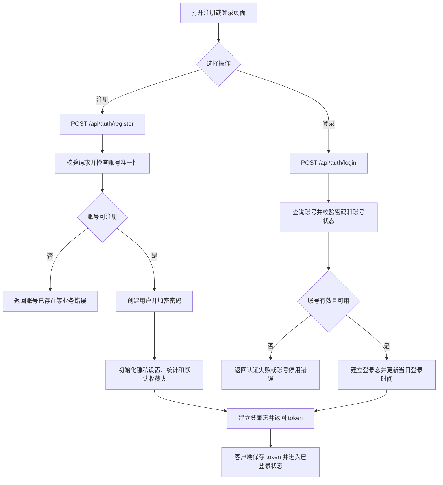

### 流程二：浏览视频、互动与弹幕

客户端先读取视频详情和互动状态，再按视频时间显示弹幕；用户可执行点赞、收藏、稍后看和观看进度上报。弹幕发布成功后更新统计，并在事务提交后向视频实时通道广播。

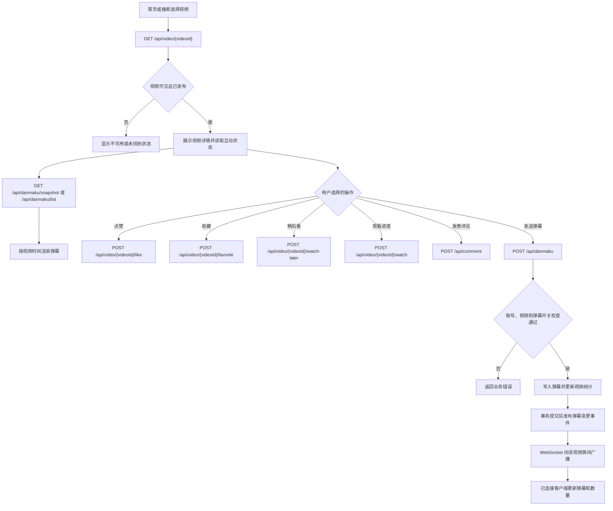

### 流程三：投稿、分片上传与审核

用户提交视频信息、封面及视频来源。大文件可先分片上传并合并；本地上传或远程视频地址经验证后，创建/更新的视频进入待审核状态。管理员审核后才会作为已发布视频提供公开浏览。

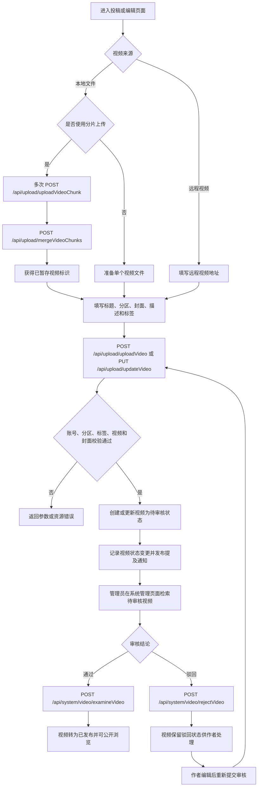

### 流程四：发布动态、关注与评论互动

用户可发布动态、查看动态流、关注用户、点赞或置顶动态，并对视频/动态发表评论。产生的评论、提及或点赞通知通过通知业务写入；私信和弹幕以各自的实时事件方式推送。

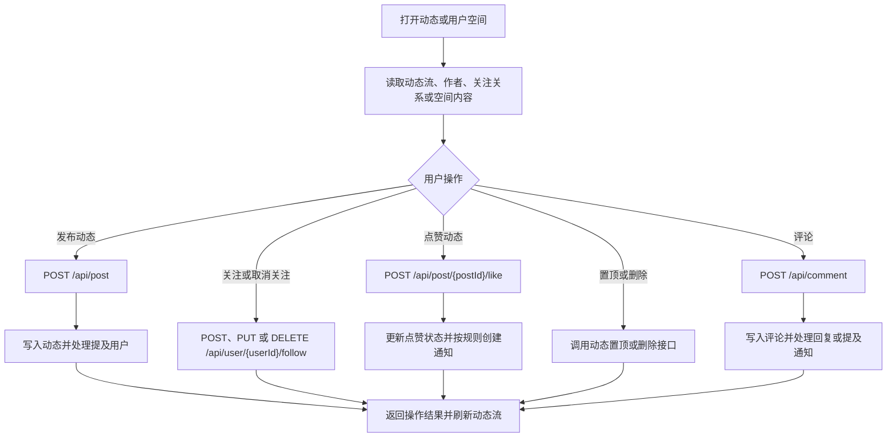

### 流程五：收藏夹、稍后看与观看历史

视频互动可将视频加入收藏夹、稍后看或记录观看历史；用户随后可在个人内容库分页浏览、移除单项、批量清理或清空列表。

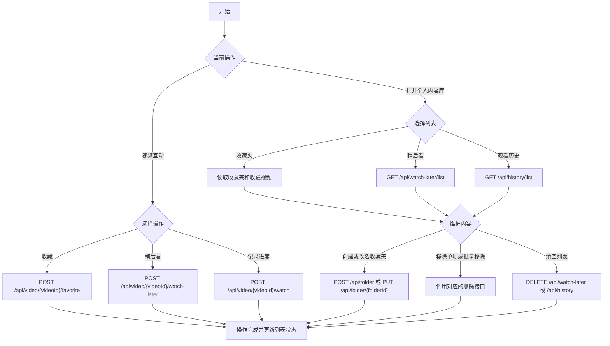

## 其他功能流程图

### 首页发现与搜索

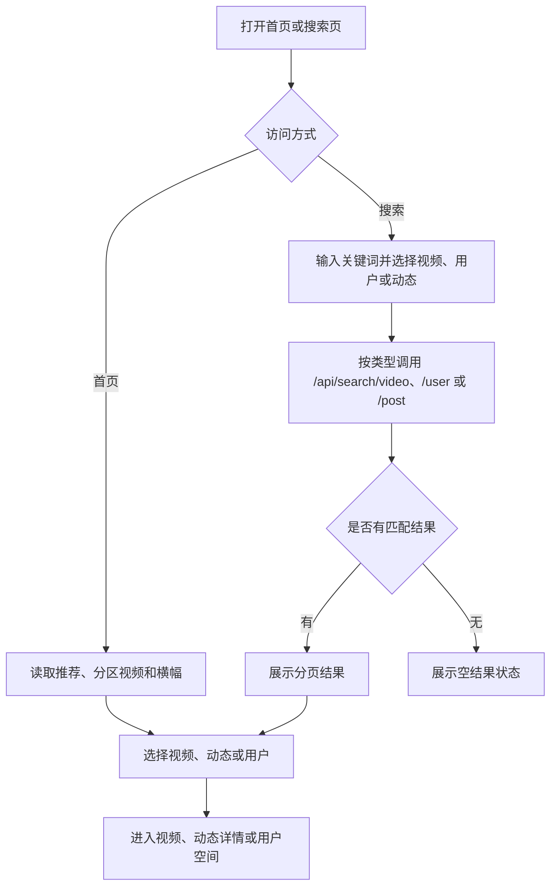

### 私信与通知

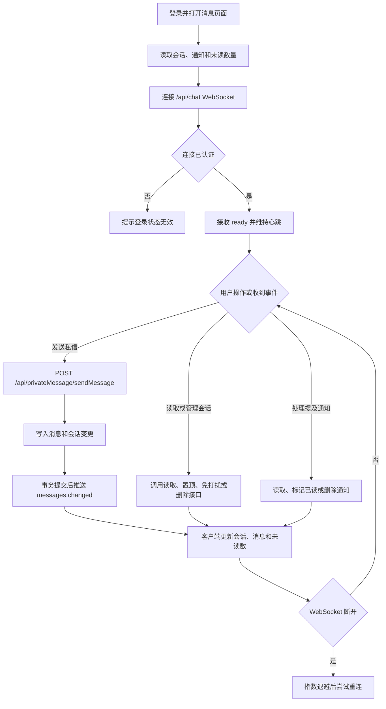

### 一起看房间与同步播放

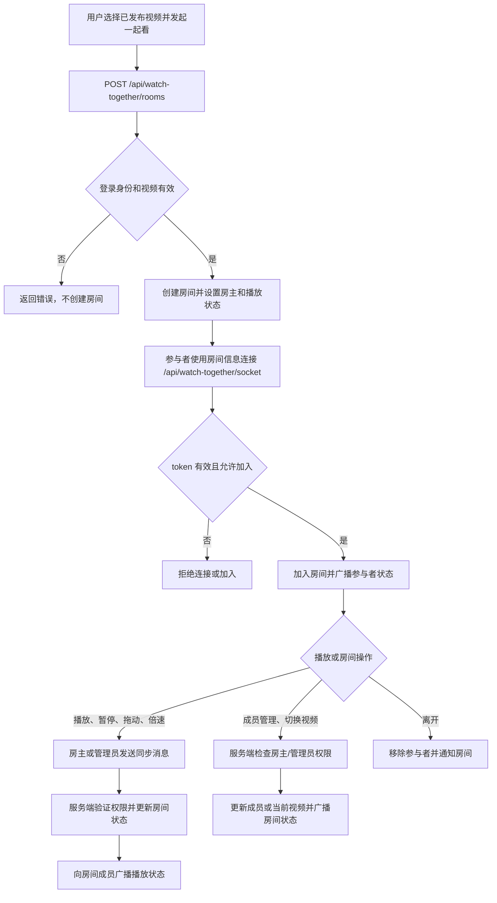

### 管理后台内容与站点运营

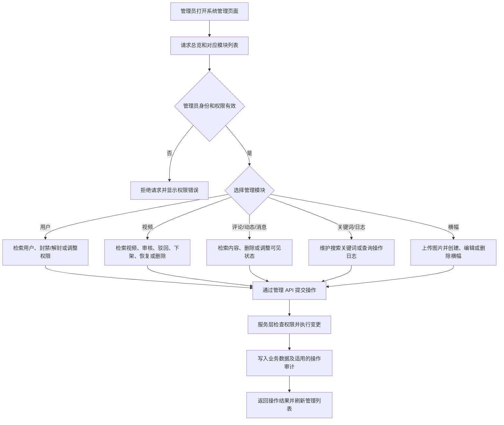

### 账号资料与媒体上传

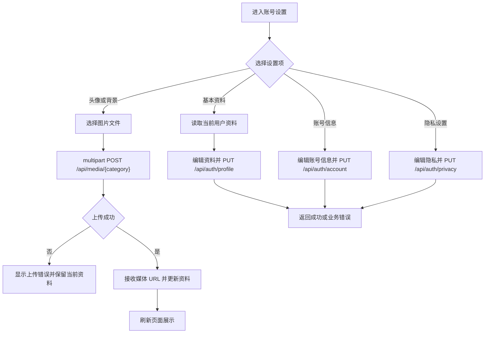

### 横幅访客浏览

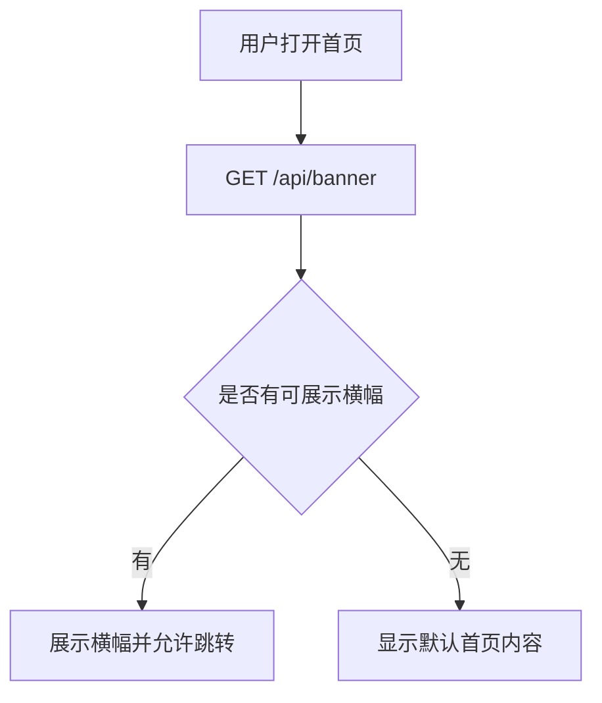

## 跨业务数据流

- **视频详情与个人化状态**：视频接口返回视频详情；观看者身份可用于返回个性化状态。互动状态也可通过 `/api/video/{videoId}/state` 单独读取。
- **注册与个人内容库初始化**：账号服务创建用户后，在注册事务中同时创建隐私设置、统计记录和默认收藏夹，减少后续访问时的缺失状态。
- **视频互动与通知**：点赞、评论、动态提及等操作可能向通知服务写入站内通知；业务变更在成功事务内完成，客户端随后刷新或读取通知。
- **弹幕与私信实时分发**：弹幕、私信分别在数据库事务提交后发布进程内变更事件，由 WebSocket 处理器向对应视频房间或用户会话推送。在线客户端收到事件后更新当前视图；断线时客户端按自身策略重连。
- **投稿与审核**：投稿服务写入待审核视频和状态记录；管理后台检索并执行审核、驳回、下架或恢复。公开视频读取只应展示符合可见状态的视频。
- **一起看房间**：房间业务读取用户和视频数据；房间状态通过 Redis 支撑的同一应用业务逻辑维护，再由 WebSocket 在参与者之间同步。未发现跨微服务数据聚合或下游服务熔断回退。

## 业务流程时序图

以下以弹幕发布为核心实时业务：先校验用户、视频及弹幕开关，再持久化弹幕并更新计数；数据库事务提交后，由实时通道广播变更。

<!-- mermaid-checked: every participant uses `participant Id as "Label"`, no \n in aliases/messages/notes, every alt/opt/loop closed by end, no `:` inside any alias -->
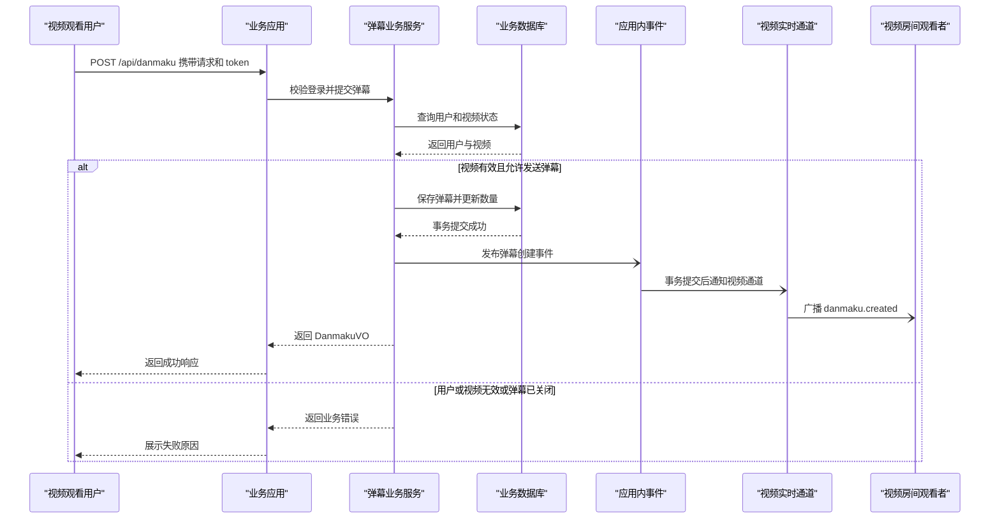

## 业务规则与决策逻辑

- **账号生命周期**：注册账号时密码经 BCrypt 哈希处理，并初始化隐私设置、用户统计和默认收藏夹；重复账号以业务错误拒绝。登录需校验账号存在、密码匹配且账号未停用。
- **视频投稿与可见性**：投稿需使用启用的分区、有效标签、封面和可用视频来源；远程视频需验证远程地址，本地视频需属于当前用户且不得重复使用。创建或编辑的投稿进入待审核状态；审核决定视频是否可公开。
- **弹幕规则**：弹幕只能针对存在且已发布、允许弹幕的视频创建。未提供颜色、字号、模式和播放时间时使用业务默认值；撤回弹幕时只允许作者删除。弹幕计数随写入/删除更新。
- **用户互动**：点赞、收藏和稍后看属于切换类操作；收藏需要目标收藏夹有效。观看进度用于维护历史记录。部分只读页面允许匿名访问，需要用户身份的写操作要求登录。
- **评论和动态**：创建、点赞、置顶、删除及提及操作均按资源归属和权限执行业务校验；提及和互动可能触发站内通知。
- **一起看**：房间仅可关联已发布视频；加入前需通过登录、房间状态和黑名单检查。播放控制、成员管理等操作需按房主/管理员权限校验；播放速率会被规范化。
- **管理与审计**：管理员操作在管理服务中检查角色权限；内容审核/删除/封禁等操作根据业务需要记录审计信息。
- **事务与错误处理**：账号初始化、投稿、互动、消息和弹幕变更等关键写操作使用事务。未发现 Saga、外部消息代理或死信队列；私信和弹幕事件在事务提交后通过进程内事件分发。业务异常由统一异常处理转换为 API 错误响应。
